I created [pandas](https://github.com/pandas-dev/pandas), co-created [Apache Arrow](https://github.com/apache/arrow) and [Ibis](https://github.com/ibis-project/ibis), and wrote [Python for Data Analysis](https://amzn.to/3DyLaJc).

Founder at [Kenn Software](https://kenn.io) · Part-time: GP at [Composed Ventures](https://composed.vc), Principal Architect and AI at [Posit](https://posit.co) · [Apache Member](https://apache.org) · [Blog](https://wesmckinney.com/archives.html) · Previously: Two Sigma, Cloudera, DataPad

What I'm building now is at **[kenn.io](https://kenn.io)**.

 &nbsp; I support open-source data science through [NumFOCUS](https://numfocus.org/) and donate at least $1000/year.
